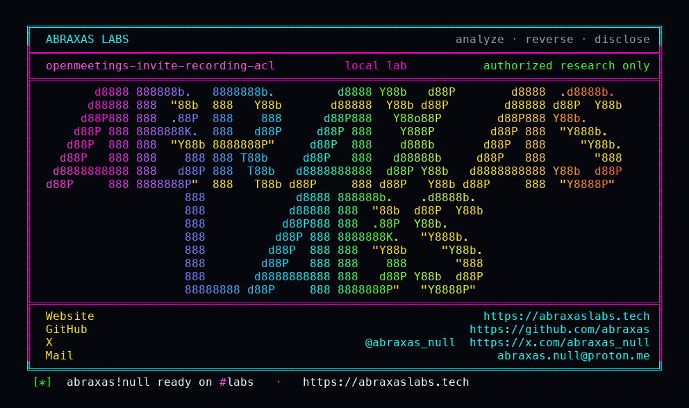

<p align="center">
  
</p>

<p align="center">
  <a href="https://abraxaslabs.tech"><strong>abraxaslabs.tech</strong></a>
  &nbsp;·&nbsp;
  <a href="https://github.com/abraxas">github.com/abraxas</a>
  &nbsp;·&nbsp;
  <a href="https://x.com/abraxas_null">@abraxas_null</a>
  &nbsp;·&nbsp;
  <a href="mailto:abraxas.null@proton.me">abraxas.null@proton.me</a>
  &nbsp;·&nbsp;
  <a href="https://github.com/abraxas/openmeetings-invite-recording-acl">openmeetings-invite-recording-acl</a>
</p>
<p align="center">
  Write-up: <a href="https://abraxaslabs.tech/research/openmeetings-9-1-0-leftovers"><strong>https://abraxaslabs.tech/research/openmeetings-9-1-0-leftovers</strong></a>
</p>


# openmeetings-invite-recording-acl

**Class:** IDOR
**Reach:** Remote

**Apache OpenMeetings** `9.1.0`. [CVE-2023-29032](https://www.cve.org/CVERecord?id=CVE-2023-29032) stopped copying Wicket ADMIN into `WebSession.rights`. `checkHashes` still `setUser(invitation.getInvitee(), hrights)`. Recording MP4 ACL keys off `ownerId == getUserId()`. A calendar invite whose invitee is `Type.USER` opens that user's recordings. CONTACT guests stay out.

| | |
|---|---|
| ID | no CVE yet |
| Class | **IDOR** |
| Reach | **Remote** (invitation hash, no password) |
| CWE | [CWE-639](https://cwe.mitre.org/data/definitions/639.html) |
| CVSS | **High: 7.5** `CVSS:3.1/AV:N/AC:L/PR:N/UI:N/S:U/C:H/I:N/A:N` |
| Product | [Apache OpenMeetings](https://github.com/apache/openmeetings) 9.1.0 |
| Auth | Type.USER invitation hash |
| License | [GNU Affero GPL v3.0](LICENSE) |
| Lab | `127.0.0.1:18156` only |

## What an attacker can do

| Method | Sink | Privilege |
|---|---|---|
| Unauth `GET /hash?invitation=` then `GET /recordings/mp4/{id}` | `WebSession.checkHashes` `setUser(invitee)` + recording owner ACL | **Recon (lab-proven):** MP4 bytes. Lab: HTTP 200 `video/mp4`, witness in body. Unauth without hash 404. CONTACT hash 404. |

**Closed:** LIKE wildcard redeem (CVE-2023-28936). CONTACT Generate-URL guests. Wicket ADMIN copy from invite.

## Lab

```bash
cd lab
./run.sh
```

Last line: `SUCCESS OPENMEETINGS-INVITE-RECORDING-WITNESS`

Suggested fix: invitation sessions keep `{ROOM}` only. Recording ACL must not treat invitee `userId` as owner.

## Contact

Abraxas Labs - https://abraxaslabs.tech - https://github.com/abraxas - https://x.com/abraxas_null - abraxas.null@proton.me

Vendor: security@openmeetings.apache.org
